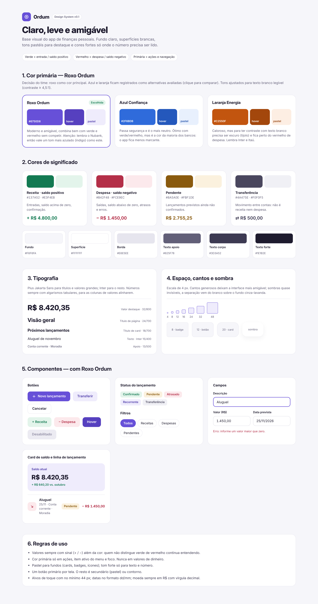
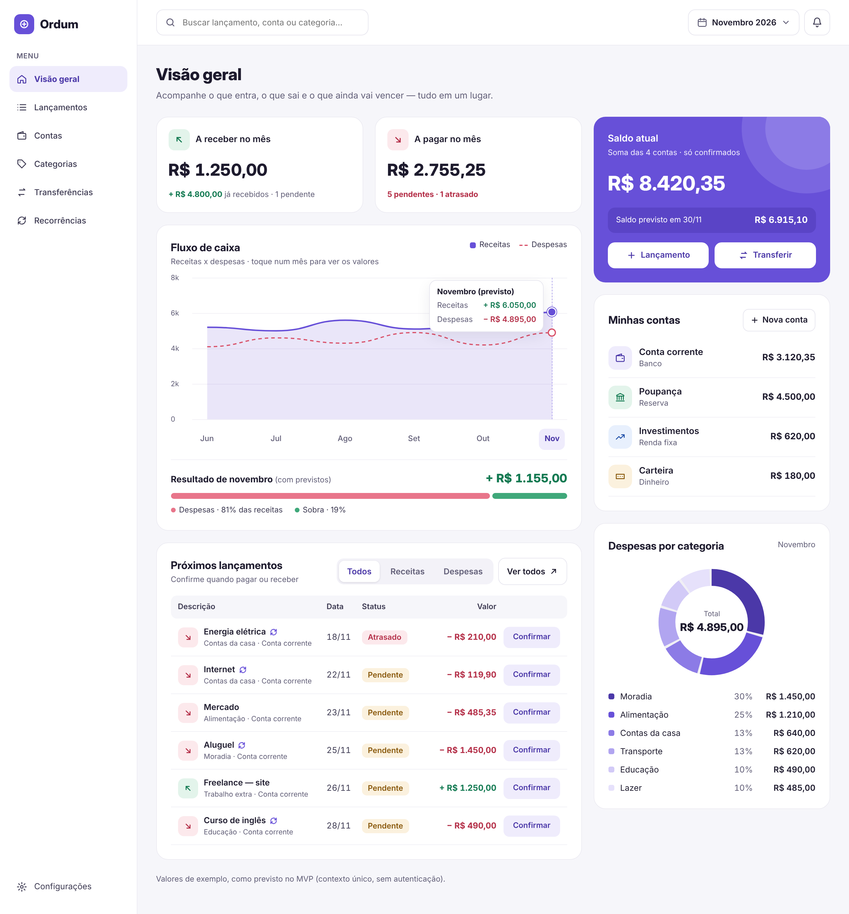

# Design System do Ordum

Base visual do frontend (Angular 22). Objetivo: uma interface **clara, leve e amigável**, com fundo claro, superfícies brancas, tons pastéis para destaque e cores fortes apenas onde o número precisa ser lido.

> Versão 0.1 — referência para a tela inicial (US-09). Atualize este documento quando uma decisão visual mudar.

## Referências usadas

- [Fundex (Tailgrids)](https://tailgrids.com/templates/fundex): menu lateral claro, busca no topo, card de saldo em destaque, gráfico de fluxo de caixa em área, rosca de categorias.
- [Finance Dashboard (Dribbble)](https://dribbble.com/shots/27425883-Finance-Dashboard): filtros segmentados, barra de resultado do mês, seletor de período.

## Princípios

1. **Claro e leve:** fundo cinza-lavanda, cards brancos, sombras quase invisíveis.
2. **Significado antes de estética:** verde é entrada/saldo positivo, vermelho é despesa/saldo negativo. Nunca usar essas cores como decoração.
3. **Cor primária só para ação:** botões, item ativo do menu, foco e seleção. Nunca em valores de dinheiro.
4. **Acessível:** texto com contraste mínimo de 4,5:1, alvos de toque com no mínimo 44 px, valores sempre com sinal (`+` / `−`) além da cor.

## Cores

### Primária — Roxo Ordum (decisão do grupo)

| Token | Hex | Uso |
|---|---|---|
| `--color-primary` | `#6750D8` | Botão primário, item ativo, gráfico de receitas |
| `--color-primary-hover` | `#5640BF` | Hover/pressionado do botão primário |
| `--color-primary-soft` | `#EFECFC` | Fundo do item ativo, botão secundário, badge "Recorrente" |
| `--color-primary-soft-text` | `#4B38A8` | Texto sobre o fundo pastel e links |

Alternativas avaliadas e descartadas: **azul** `#2F6BDB` (seguro, mas igual à maioria dos bancos) e **laranja** `#C2550F` (para ter contraste precisa ser escuro e fica próximo do vermelho de despesa).

### Cores de significado

| Token | Forte | Pastel | Uso |
|---|---|---|---|
| `positive` | `#137A52` | `#E3F4EB` | Receitas, saldo positivo, status Confirmado |
| `negative` | `#B42F48` | `#FCE9EC` | Despesas, saldo negativo, status Atrasado, erros |
| `pending` | `#8A5A0E` | `#FBF1DE` | Status Pendente (previsto e não confirmado) |
| `transfer` | `#4A475E` | `#F0F0F5` | Transferências entre contas (não é receita nem despesa) |

Nos gráficos, usar os tons médios `#3FA87A` (receita) e `#E8758A` / `#D9536B` (despesa) para áreas e barras.

### Neutros

| Token | Hex | Uso |
|---|---|---|
| `--color-bg` | `#F6F6FA` | Fundo da aplicação |
| `--color-surface` | `#FFFFFF` | Cards, menu, barra superior |
| `--color-border` | `#E6E5EE` | Bordas de cards e campos |
| `--color-text-muted` | `#625F78` | Textos de apoio, legendas |
| `--color-text-body` | `#3D3A52` | Texto corrido |
| `--color-text-strong` | `#1E1B2E` | Títulos e valores |

## Tipografia

- **Títulos e valores grandes:** [Plus Jakarta Sans](https://fonts.google.com/specimen/Plus+Jakarta+Sans) (600, 700, 800).
- **Interface e texto:** [Inter](https://fonts.google.com/specimen/Inter) (400, 500, 600, 700).
- **Números:** sempre com `font-variant-numeric: tabular-nums`, para os valores alinharem em colunas.

| Estilo | Fonte | Tamanho / peso |
|---|---|---|
| Valor destaque | Plus Jakarta Sans | 28–34 px / 800 |
| Título de página | Plus Jakarta Sans | 28 px / 800 |
| Título de card | Plus Jakarta Sans | 18 px / 700 |
| Texto | Inter | 15 px / 400 |
| Apoio, legendas | Inter | 13 px / 500 |

## Espaçamento, cantos e sombra

- **Escala de espaço (4 px):** 4, 8, 12, 16, 20, 24, 32, 48.
- **Raios:** 8 px (badges), 12 px (botões e campos), 20 px (cards), `999px` (pílulas).
- **Sombra:** `0 1px 2px rgba(30,27,46,.04), 0 8px 24px rgba(30,27,46,.06)` — usar pouco; a separação vem do branco sobre o fundo.

## Componentes

- **Botão primário:** fundo `primary`, texto branco, altura 44 px. Apenas um por tela.
- **Botão secundário:** fundo `primary-soft`, texto `primary-soft-text`.
- **Botão contorno:** fundo branco, borda `border`.
- **Botões de receita/despesa:** fundo pastel com texto forte da cor de significado.
- **Status do lançamento:** Confirmado (verde), Pendente (âmbar), Atrasado (vermelho), Recorrente (roxo pastel), Transferência (cinza).
- **Filtros:** controle segmentado (Todos / Receitas / Despesas) com o item ativo em branco sobre fundo `#F3F2F8`.
- **Campos:** rótulo visível acima (`<label>`), altura 44 px, borda `#D9D8E3`, foco com borda de 2 px `primary`, mensagem de erro em `negative`.
- **Linha de lançamento:** ícone de seta (↘ despesa, ↖ receita) em quadrado pastel, descrição, categoria · conta, data `dd/mm`, status, valor com sinal e ação Confirmar/Desfazer.

## Tela inicial (US-09)

Conteúdo, alinhado ao [Escopo do MVP](ESCOPO.md) e ao [Backlog](BACKLOG.md):

- **Menu lateral:** Visão geral, Lançamentos, Contas, Categorias, Transferências, Recorrências e Configurações.
- **Barra superior:** busca de lançamentos e seletor de mês.
- **Cards de resumo:** A receber no mês, A pagar no mês e Saldo atual (com o Saldo previsto para o fim do mês e atalhos para Novo lançamento e Transferir).
- **Fluxo de caixa:** receitas x despesas dos últimos 6 meses, com resultado do mês (quanto das receitas foi para despesas e quanto sobrou).
- **Minhas contas:** saldo por conta e atalho para nova conta.
- **Próximos lançamentos:** filtro por tipo e ação de Confirmar/Desfazer (US-04).
- **Despesas por categoria:** gráfico de rosca com valor e percentual.

Os valores da imagem são de exemplo. Fora do MVP e por isso ausentes da tela: cartões, metas e dados do usuário logado.

## Formato de dados na interface

- Moeda: `R$ 1.450,00` (BRL, vírgula decimal, ponto de milhar).
- Datas: `dd/mm` em listas, `dd/mm/aaaa` em formulários.
- Valores sempre com sinal: `+ R$ 1.250,00` / `− R$ 490,00`.
