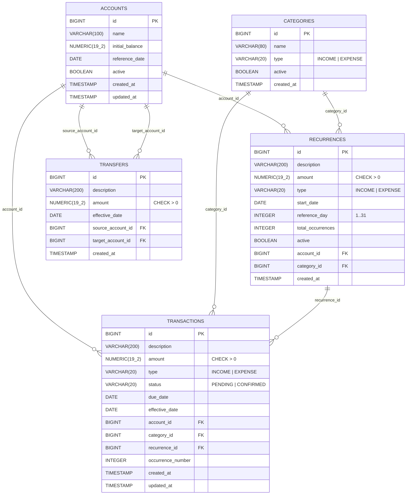
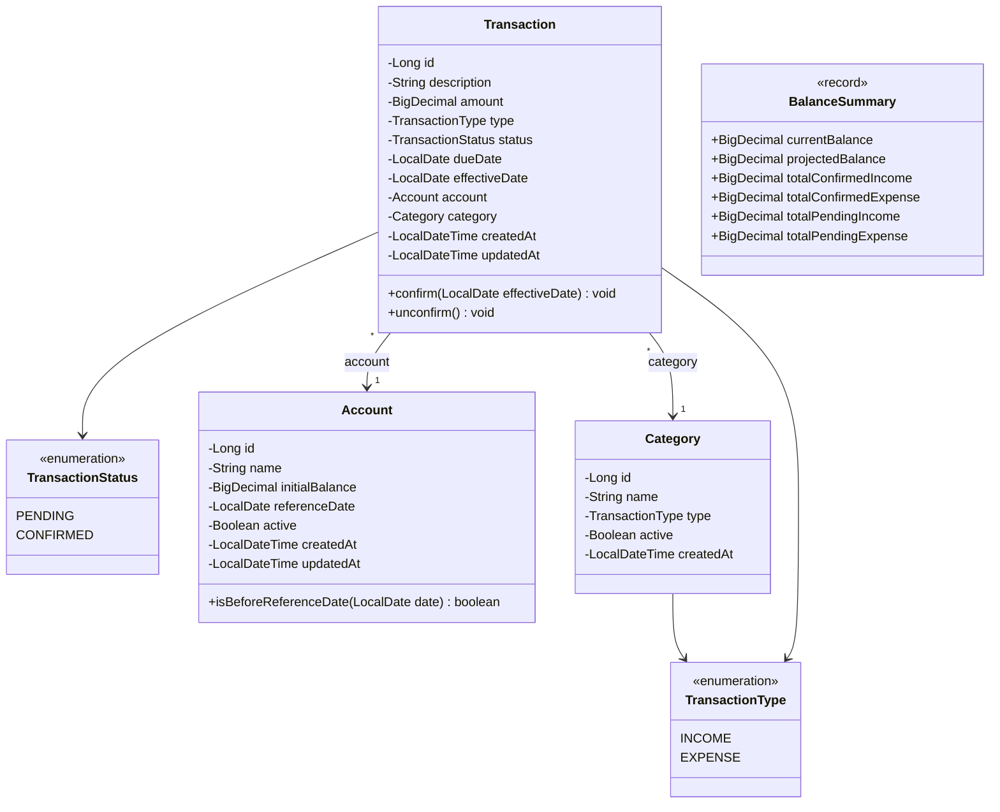
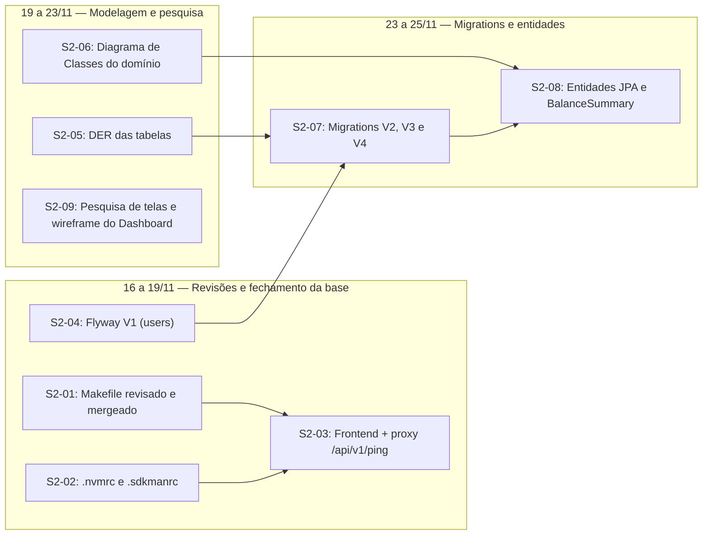

# Planejamento e Guia da Sprint 2 — Ordum

> **Período / Duração:** 2 semanas (14 dias corridos)
> **Meta da Sprint 2:** Consolidar e validar na `main` todas as entregas pendentes da Sprint 1 (`Makefile`, `Flyway` e `Frontend`), padronizar o ambiente de versões locais (`.nvmrc` e `.sdkmanrc`), concluir a modelagem técnica (DER e Diagrama de Classes), iniciar as migrações granulares e entidades do domínio financeiro (`Account`, `Category`, `Transaction`, cálculo de Saldos) e estruturar a pesquisa visual do Dashboard.

---

## 1. Diagnóstico do Repositório na Entrada da Sprint 2

> **Estado verificado em 12/11/2026** (`main` = `c6ebf9a`, sincronizada com `origin/main`).
>
> - **Três Pull Requests da Sprint 1 seguem abertos e sem revisão:** [#9 — Flyway](https://github.com/forgestack-team/ordum/pull/9), [#10 — Frontend](https://github.com/forgestack-team/ordum/pull/10) e [#11 — Makefile](https://github.com/forgestack-team/ordum/pull/11). Nenhum tem revisor atribuído, labels ou milestone.
> - **A `main` não contém** `Makefile`, `frontend/` nem `backend/src/main/resources/db/migration/` — os três objetivos de fechamento da Sprint 1 dependem exclusivamente do merge desses PRs.
> - **A milestone `Sprint 1 - Infraestrutura e Bootstrap` venceu em 11/11/2026 e continua aberta**, com 4 issues abertas (#1, #4, #5 e #6).
> - **Estado local:** `main` sincronizada com `origin/main` e sem alteração de código; há apenas documentação não commitada (`SPRINT_2.md` novo e ajustes em `ARQUITETURA`, `BACKLOG`, `DECISOES` e `README`).

### 1.1. Riscos técnicos identificados na revisão dos PRs abertos

| PR | Risco / pendência encontrada | Ação na Sprint 2 |
| :--- | :--- | :--- |
| **#11 Makefile** | `make run-front` executa `npm install` em toda execução; não existe `make test-front`; `status`, `down`, `logs` e `reset-db` não dependem do target `env` e falham se `infra/.env` não existir | S2-01 |
| **#10 Frontend** | O PR reescreve o `.gitignore` da raiz e **remove** entradas existentes (`.classpath`, `.project`, `.settings`); o merge gera conflito e pode derrubar proteções da `main` | S2-03 |
| **#10 Frontend** | `package-lock.json` gerado com `npm@11.19.1` (Node 24), enquanto o plano citava Node 22.14.0 | S2-02 |
| **#9 Flyway** | `FlywayStatusPrinter.java` com a classe inteira indentada dentro do pacote (compila, fora do padrão); `V1__baseline.sql` sem quebra de linha final; `users` sem `created_at` | S2-04 |

### 1.2. Ambiente local verificado

| Ferramenta | Windows (host) | WSL Ubuntu | Observação |
| :--- | :--- | :--- | :--- |
| Git | ✅ `C:\Program Files\Git` | ✅ | — |
| Node.js / npm | ✅ 24.21.0 / 11.19.0 | ❌ ausente | fixar em `.nvmrc` |
| Java 21 | ❌ ausente | ❌ ausente | fixar em `.sdkmanrc` |
| Docker | ✅ Docker Desktop | ❌ sem integração | ativar integração WSL se o time usar WSL |
| Make | ❌ ausente | ✅ 4.4.1 | no Windows, rodar `make` via WSL/Git Bash |
| gh CLI | ❌ ausente | ❌ ausente | gestão do board pela web/API |

Antes de iniciar as novas implementações, a equipe deve concluir a revisão e o merge das branches remotas remanescentes da Sprint 1:

| Entrega | Branch | Autor | Status Atual | O que o time precisa validar antes/durante o Merge |
| :--- | :--- | :--- | :--- | :--- |
| **Infra Docker (PG 18)** | `main` | Matheus | ✅ Na `main` | Já integrada (PR #7). |
| **Bootstrap Backend** | `main` | Marcelo | ✅ Na `main` | Já integrada (PR #8) com `GET /api/v1/ping` e leitura de `infra/.env`. |
| **Automação Makefile** | `origin/chore/makefile` | Fábio | ⏳ PR [#11](https://github.com/forgestack-team/ordum/pull/11) aberto | Testar `make help`, `make env`, `make up`, `make status`, `make logs`, `make run-back`, `make run-front`, `make test`, `make clean`, `make reset-db`. Sugestão: adicionar `test-front` e evitar rodar `npm install` toda vez se `node_modules` já existir. |
| **Flyway Baseline** | `origin/chore/setup-flyway-migrations` | Lucas Yago | ⏳ PR [#9](https://github.com/forgestack-team/ordum/pull/9) aberto | Verificar configuração no `application.yaml`, ajustar indentação de `FlywayStatusPrinter.java` e confirmar que `V1__baseline.sql` (tabela `users`) executa sem erros ao subir o backend. |
| **Bootstrap Frontend** | `origin/feature/frontend` | Bianca | ⏳ PR [#10](https://github.com/forgestack-team/ordum/pull/10) aberto | Cuidar para **não sobrescrever** regras do `.gitignore` da raiz no merge. Validar se `ng serve` (porta `4200`) conecta ao backend (`8080`) via `proxy.conf.json` e exibe status `Online` na tela inicial. |

---

## 2. Capacidade da Equipe (16/11 a 25/11/2026)

> As horas por integrante foram informadas pelo time; confirmar na planning e ajustar se alguém tiver semana atípica.
>
> **Atenção ao calendário:** a janela 16–25/11 tem **7 dias úteis** (16 a 19/11 e 23 a 25/11), porque **20/11 (sexta) é feriado nacional** (Dia Nacional de Zumbi e da Consciência Negra, Lei 14.759/2023). A tabela abaixo pressupõe duas semanas cheias; para esta janela a capacidade líquida cai para cerca de **29h** (~70% de 41,5h). As estimativas atuais (36,5h, sem contar a construção da tela inicial) **não cabem** — a planning precisa cortar escopo.

Considerando a disponibilidade semanal de cada integrante e reservando **~20% do tempo** para revisão de Pull Requests (Code Review), cerimônias e alinhamento em dupla:

| Integrante | Papel | Horas / Semana | Total Bruto (2 sem.) | Reserva Review/Alinhamento | Capacidade Líquida p/ Tasks |
| :--- | :--- | :---: | :---: | :---: | :---: |
| **Matheus** | PO / Dev Full Stack | 6h | 12h | 2,5h | **9,5h** |
| **Marcelo Rodrigues** | Dev Full Stack | 6h | 12h | 2,5h | **9,5h** |
| **Bianca Salomão** | Dev Full Stack | 6h | 12h | 2,5h | **9,5h** |
| **Fábio** | Dev Full Stack | 4h | 8h | 1,5h | **6,5h** |
| **Lucas Yago** | Dev Full Stack | 4h | 8h | 1,5h | **6,5h** |
| **Total do Time** | — | **26h/sem** | **52h** | **10,5h** | **41,5h** |

**Alocação por pessoa (capacidade líquida × horas alocadas):**

| Integrante | Capacidade líquida | Alocado nas tarefas | Folga | Observação |
| :--- | :---: | :---: | :---: | :--- |
| **Matheus** | 9,5h | 9,5h (S2-06, S2-07, S2-08) | 0h | 100% — sem margem |
| **Marcelo** | 9,5h | 6,0h (S2-08) | 3,5h | buffer de correção |
| **Bianca** | 9,5h | 9,5h (S2-03, S2-09) | 0h | 100% — sem margem |
| **Fábio** | 6,5h | 5,0h (S2-01, S2-02) | 1,5h | buffer de correção |
| **Lucas** | 6,5h | 6,5h (S2-04, S2-05, S2-07) | 0h | 100% — sem margem |
| **Total** | **41,5h** | **36,5h** | **5,0h** | — |

> **Buffer declarado (5h):** Marcelo (3,5h) e Fábio (1,5h) ficam reservados para **correções nos PRs #9, #10 e #11** durante a onda 1, que já apresentaram pendências na revisão. Não alocar novas tarefas nesse intervalo; se os PRs passarem sem ajuste, o tempo vai para S2-08.

---

## 3. Roteiro Técnico dos Objetivos da Sprint 2 (O que a equipe deve fazer)

> **Convenção definida:** Todo código-fonte e objetos do banco de dados devem ser escritos em **inglês** (`Account`, `Category`, `Transaction`, `accounts`, `categories`, `transactions`). Toda documentação e artefatos de negócio permanecem em **português**.

### 3.1. Confirmar funcionamento do `Makefile` + Criar `.nvmrc` e `.sdkmanrc`
- **O que fazer:**
  1. Revisar e aprovar o PR da branch `chore/makefile` para a `main`.
  2. Criar na raiz do projeto o arquivo `.nvmrc` fixando a versão LTS do Node.js compatível com o Angular 22 (ex: `24.21.0`, mesmo runtime usado para gerar o `package-lock.json`; Angular 22 também roda em Node 22 LTS).
  3. Criar na raiz do projeto o arquivo `.sdkmanrc` fixando o JDK 21 (ex: `java=21.0.13.0+9-tem`).
  4. Documentar no `README.md` raiz como usar `nvm use` e `sdk env` junto com os comandos `make`.

### 3.2. Confirmar funcionamento do Frontend e sua conexão com o Backend
- **O que fazer:**
  1. Revisar o PR da branch `feature/frontend` garantindo que o `.gitignore` da raiz mantenha todas as proteções já presentes na `main`.
  2. Subir o ambiente completo (`make up`, `make run-back`, `make run-front`).
  3. Validar no navegador (`http://localhost:4200`) se a chamada ao `/api/v1/ping` passa pelo `proxy.conf.json` e altera o sinal `apiStatus` de `"Verificando"` para `"Online"`.
  4. Executar `npm test` e `npm run lint` na pasta `frontend/` para confirmar que os testes unitários com Vitest e o linter passam sem erros.

### 3.3. Confirmar organização do Flyway com migrações granulares
- **O que fazer:**
  1. Mergear a branch `chore/setup-flyway-migrations` na `main`, mantendo `V1__baseline.sql` com a tabela `users`.
  2. Padronizar o diretório `backend/src/main/resources/db/migration/` com **migrações granulares** (uma responsabilidade clara por arquivo SQL):
     - `V1__baseline.sql` — Tabela `users` (já criada).
     - `V2__create_accounts_table.sql` — Tabela `accounts` (contas bancárias/carteiras, `initial_balance NUMERIC(19,2) DEFAULT 0.00`, `reference_date DATE`).
     - `V3__create_categories_table.sql` — Tabela `categories` (categorias com `type` = `INCOME` ou `EXPENSE`).
     - `V4__create_transactions_table.sql` — Tabela `transactions` (receitas e despesas, `amount NUMERIC(19,2) > 0`, `type`, `status` = `PENDING` ou `CONFIRMED`, `due_date DATE`, `effective_date DATE`, FKs para `accounts` e `categories`).
     - *(Para a evolução de recorrências e transferências)* `V5__create_recurrences_table.sql` e `V6__create_transfers_table.sql`.

### 3.4. Criar Diagrama de Relacionamento das Tabelas (DER)
- **O que fazer:**
  1. Elaborar e validar em equipe o DER (pode usar Mermaid `erDiagram`, dbdiagram.io ou Draw.io e salvar em `docs/MODELAGEM.md`).
  2. Garantir que o DER contemple as regras de negócio de [REGRAS_DO_NEGOCIO.md](REGRAS_DO_NEGOCIO.md):
     - `accounts`: `id`, `name`, `initial_balance` (`NUMERIC(19,2)`), `reference_date` (`DATE`), `active`, `created_at`, `updated_at`.
     - `categories`: `id`, `name`, `type` (`INCOME` | `EXPENSE`), `active`, `created_at`.
     - `transactions`: `id`, `description`, `amount` (`NUMERIC(19,2)`), `type` (`INCOME` | `EXPENSE`), `status` (`PENDING` | `CONFIRMED`), `due_date` (`DATE`), `effective_date` (`DATE`), `account_id` (FK), `category_id` (FK), `recurrence_id` (FK opcional), `occurrence_number` (opcional).
     - `transfers`: `id`, `description`, `amount` (`NUMERIC(19,2)`), `effective_date` (`DATE`), `source_account_id` (FK), `target_account_id` (FK, diferente de `source_account_id`).
     - `recurrences`: `id`, `description`, `amount` (`NUMERIC(19,2)`), `type`, `start_date` (`DATE`), `reference_day` (`1..31`), `total_occurrences` (`NULL` para contínua), `active`, `account_id` (FK), `category_id` (FK).

#### Referência de DER em Mermaid para a equipe discutir e refinar:

### 3.5. Criar Diagrama de Classes e Estruturar Entidades (`Account`, `Category`, `Transaction`, Saldos)
- **O que fazer:**
  1. Documentar o Diagrama de Classes do pacote `br.com.ordum.domain` em `docs/MODELAGEM.md`.
  2. Criar os Enums em `br.com.ordum.domain`:
     - `TransactionType` (`INCOME`, `EXPENSE`)
     - `TransactionStatus` (`PENDING`, `CONFIRMED`)
  3. Criar as entidades JPA mapeadas com precisão para as migrations (`ddl-auto: validate` exige correspondência exata de nomes e tipos):
     - `Account`: campos `id`, `name`, `initialBalance` (`BigDecimal`), `referenceDate` (`LocalDate`), `active`, `createdAt`, `updatedAt`.
     - `Category`: campos `id`, `name`, `type` (`@Enumerated(EnumType.STRING)`), `active`, `createdAt`.
     - `Transaction`: campos `id`, `description`, `amount` (`BigDecimal`), `type`, `status`, `dueDate` (`LocalDate`), `effectiveDate` (`LocalDate`), `@ManyToOne(fetch = FetchType.LAZY) Account account`, `@ManyToOne(fetch = FetchType.LAZY) Category category`, métodos de domínio `confirm(LocalDate effectiveDate)` e `unconfirm()`.
  4. Definir a estrutura de representação de Saldos (ex: record/VO `BalanceSummary` contendo `currentBalance`, `projectedBalance`, `totalConfirmedIncome`, `totalConfirmedExpense`, `totalPendingIncome`, `totalPendingExpense`), lembrando que **saldo atual** e **saldo previsto** são calculados a partir de `initialBalance` + lançamentos confirmados/pendentes, sem coluna de saldo mutável acoplada na tabela `accounts`.

#### Referência de Diagrama de Classes para a equipe:

### 3.6. Pesquisar Telas para Criação do Dashboard
- **O que fazer:**
  1. Pesquisar 3 a 4 referências visuais de sistemas de finanças pessoais (ex: Organizze, Mobills, Actual Budget, YNAB, templates de Dashboard financeiro no Dribbble/Figma Community).
  2. Definir como os conceitos centrais do Ordum aparecerão na tela principal:
     - **Cards de Resumo (KPIs):** Saldo Atual Geral, Saldo Previsto (até o fim do mês selecionado), Total de Receitas (Confirmadas vs. Previstas) e Total de Despesas (Confirmadas vs. Previstas).
     - **Visão por Conta:** Lista lateral ou seção com o saldo individual de cada conta cadastrada.
     - **Lista Rápida de Lançamentos / Pendências:** Destaque visual para pendências atrasadas e botão rápido de confirmação manual.
  3. Definir se o frontend usará apenas SCSS puro/CSS Grid com variáveis de tema (Design Tokens) ou alguma biblioteca auxiliar (ex: Tailwind CSS, Angular Material ou PrimeNG).
  4. Registrar o resultado da pesquisa e um wireframe/rascunho das telas em `docs/PESQUISA_DASHBOARD.md` (ou no Figma da equipe com link na documentação).

---

## 4. Cronograma e Divisão de Tarefas (16/11/2026 a 25/11/2026)

**Calendário:** início 16/11 (segunda), fim 25/11 (quarta) — 10 dias corridos, **7 dias úteis** (20/11 é feriado nacional).
**Cerimônias:** planning em 16/11, checkpoints em 19/11 e 23/11, review + retro em 25/11.

### Matriz de Responsabilidades Sugerida para a Sprint 2

> **Atribuições em aberto:** na planning de 16/11 apenas a **revisão do frontend (S2-03)** está confirmada. Responsáveis, estimativas e ordem das demais tarefas serão definidos com o grupo; a matriz abaixo é ponto de partida, não compromisso.

| Código | Tarefa | Responsável Principal | Revisor / Par | Estimativa | Semana Alvo |
| :--- | :--- | :--- | :--- | :---: | :---: |
| **S2-01** | Confirmar funcionamento do `Makefile` e mergear na `main` | **Fábio** | Matheus | 3h | Semana 1 |
| **S2-02** | Criar arquivos `.nvmrc` e `.sdkmanrc` e atualizar `README.md` | **Fábio** | Marcelo | 2h | Semana 1 |
| **S2-03** | Confirmar funcionamento do Frontend, conexão com Backend (`/api/v1/ping`) e mergear na `main` | **Bianca Salomão** | Marcelo | 3,5h | Semana 1 |
| **S2-04** | Confirmar organização do Flyway (`V1__baseline.sql` com `users`) e mergear na `main` | **Lucas Yago** | Matheus | 2h | Semana 1 |
| **S2-05** | Criar Diagrama de Relacionamento das Tabelas (DER) em `docs/MODELAGEM.md` | **Lucas Yago** | Marcelo | 3h | Semana 1 |
| **S2-06** | Criar Diagrama de Classes do Domínio em `docs/MODELAGEM.md` | **Matheus** | Lucas Yago | 3,5h | Semana 1 |
| **S2-07** | Criar migrations granulares: `V2__create_accounts_table.sql`, `V3__create_categories_table.sql`, `V4__create_transactions_table.sql` | **Lucas Yago** + **Matheus** | Marcelo | 3h (1,5h + 1,5h) | Semana 2 |
| **S2-08** | Estruturar entidades JPA (`Account`, `Category`, `Transaction`, Enums) e modelo de Saldos (`BalanceSummary`) + repositórios base | **Marcelo Rodrigues** + **Matheus** | Lucas Yago | 10,5h (6h + 4,5h) | Semana 2 |
| **S2-09** | Pesquisar telas para criação do Dashboard, definir paleta/componentes e documentar wireframe em `docs/PESQUISA_DASHBOARD.md` | **Bianca Salomão** | Fábio (1,5h) | 6h | Semana 1 e 2 |

---

## 5. Guia Prático: Como Organizar no Jira e no GitHub

Para manter rastreabilidade entre o quadro ágil (**Jira**) e o código (**GitHub Milestones, Issues e Pull Requests**), utilize a estrutura abaixo.

### 5.1. Estrutura Recomendada no Jira

1. **Épicos (Epics) ativos na Sprint 2:**
   - `EP01 - Infraestrutura e Bootstrap` *(para as tarefas de fechamento: Makefile, Flyway base, Frontend conexões, `.nvmrc` e `.sdkmanrc`)*
   - `EP02 - Gestão de Contas e Categorias` / `EP03 - Lançamentos Financeiros e Saldos` *(para DER, Diagrama de Classes, Migrations e Entidades base)*
   - `EP06 - Dashboard e Visão Consolidada` *(para a task de Pesquisa de Telas do Dashboard)*

2. **Configuração da Sprint no Jira:**
   - **Nome:** `Sprint 2 - Base, Modelagem e Domínio Financeiro`
   - **Duração:** 2 semanas
   - **Meta da Sprint (Sprint Goal):** *"Ter o ambiente unificado na main (Makefile, Flyway, Frontend, .nvmrc, .sdkmanrc), modelagem DER e Classes documentada, migrações e entidades base (Account, Category, Transaction) validadas no banco e definição visual do Dashboard."*

3. **Colunas sugeridas no Board do Jira:**
   - `TO DO` → `IN PROGRESS` → `IN CODE REVIEW (PR ABERTO)` → `READY TO MERGE / QA` → `DONE`

4. **Padrão de Nomenclatura de Branches e Commits vinculados ao Jira/GitHub:**
   - Branch: `<tipo>/S2-<numero>-<slug-curto>`
     - Exemplos: `chore/S2-02-version-files`, `docs/S2-05-der-diagram`, `feat/S2-07-financial-migrations`, `feat/S2-08-domain-entities`.
   - Commit: `feat(domain): create Account, Category and Transaction entities (#12)`

---

### 5.2. Estrutura Recomendada no GitHub (Milestones e Labels)

#### Passo 1: Criar Labels no GitHub (`Issues` > `Labels`)
| Nome da Label | Cor Sugerida | Descrição |
| :--- | :--- | :--- |
| `sprint-2` | `#0E8A16` (Verde) | Tarefas pertencentes à Sprint 2 |
| `area:infra` | `#5319E7` (Roxo) | Docker, Makefile, `.nvmrc`, `.sdkmanrc` |
| `area:backend` | `#1D76DB` (Azul) | Java 21, Spring Boot, JPA, Flyway |
| `area:frontend` | `#D93F0B` (Laranja) | Angular 22, UI/UX, Dashboard |
| `area:docs` | `#FEF2C0` (Amarelo) | Documentação, DER, Diagrama de Classes, Pesquisa |
| `type:feature` | `#A2EEEF` (Ciano) | Nova funcionalidade ou estrutura de domínio |
| `type:chore` | `#CFD3D7` (Cinza) | Configuração, automação e manutenção |

#### Passo 2: Criar a Milestone da Sprint 2 (`Issues` > `Milestones` > `New milestone`)
- **Title:** `Sprint 2: Consolidação, Modelagem e Entidades Base`
- **Due date:** *(Data de término daqui a 14 dias)*
- **Description:**
  > Consolidação das branches da Sprint 1 na `main` (`Makefile`, `Flyway`, `Frontend`), arquivos `.nvmrc` e `.sdkmanrc`, modelagem DER e Diagrama de Classes, migrações granulares (`V2` a `V4`), entidades de domínio (`Account`, `Category`, `Transaction`, `BalanceSummary`) e pesquisa de telas para o Dashboard.

---

### 5.3. Cards Prontos para Copiar e Colar (Jira Tasks & GitHub Issues)

Abaixo estão os 9 cards prontos para cadastrar como **Tasks no Jira** e/ou **Issues no GitHub** associadas à Milestone `Sprint 2`:

---

#### Card `S2-01` — Confirmar funcionamento do Makefile e integrar na `main`
- **Tipo:** Task (`type:chore`, `area:infra`, `sprint-2`)
- **Épico:** `EP01 - Infraestrutura e Bootstrap`
- **Responsável:** Fábio | **Revisor:** Matheus | **Estimativa:** 3h
- **Descrição:**
  Revisar, testar e integrar a branch `origin/chore/makefile` na `main`, garantindo que todos os comandos de orquestração funcionem com a infraestrutura Docker, o backend Spring Boot e o frontend Angular.
- **Checklist / Subtarefas:**
  - [ ] Testar `make help`, `make env`, `make up`, `make status`, `make logs`, `make down` e `make reset-db`.
  - [ ] Testar `make run-back`, `make test` e `make clean`.
  - [ ] Ajustar `make run-front` para só rodar `npm install` caso `frontend/node_modules` não exista (ou criar target `install-front`) e adicionar `make test-front`.
  - [ ] Abrir/aprovar Pull Request e realizar merge na `main`.
- **Critérios de Aceite:**
  - Todos os comandos do `Makefile` executam sem erro a partir da raiz do repositório.

---

#### Card `S2-02` — Criar arquivos `.nvmrc` e `.sdkmanrc` na raiz do projeto
- **Tipo:** Task (`type:chore`, `area:infra`, `sprint-2`)
- **Épico:** `EP01 - Infraestrutura e Bootstrap`
- **Responsável:** Fábio | **Revisor:** Marcelo Rodrigues | **Estimativa:** 2h
- **Descrição:**
  Padronizar as versões locais de Node.js e Java 21 entre os 5 integrantes da equipe utilizando arquivos de configuração de gerenciadores de versão.
- **Checklist / Subtarefas:**
  - [ ] Criar arquivo `.nvmrc` na raiz com a versão do Node usada pelo projeto (ex: `24.21.0`).
  - [ ] Criar arquivo `.sdkmanrc` na raiz fixando a distribuição Java 21 LTS (ex: `java=21.0.13.0+9-tem`).
  - [ ] Adicionar seção curta no `README.md` explicando como rodar `nvm use` e `sdk env`.
- **Critérios de Aceite:**
  - Comandos `nvm use` e `sdk env` selecionam automaticamente o Node e o JDK 21 na raiz do projeto.

---

#### Card `S2-03` — Confirmar funcionamento do Frontend e conexão com o Backend
- **Tipo:** Task (`type:chore`, `area:frontend`, `sprint-2`)
- **Épico:** `EP01 - Infraestrutura e Bootstrap`
- **Responsável:** Bianca Salomão | **Revisor:** Marcelo Rodrigues | **Estimativa:** 3,5h
- **Descrição:**
  Validar a branch `origin/feature/frontend` integrada ao backend Spring Boot (`GET /api/v1/ping`), garantindo que o proxy reverso e os testes unitários estejam funcionando, e realizar o merge na `main`.
- **Checklist / Subtarefas:**
  - [ ] Revisar conflitos ou diferenças no `.gitignore` da raiz para preservar todas as regras da `main`.
  - [ ] Executar `npm test` (Vitest) e `npm run lint` (ESLint) em `frontend/`.
  - [ ] Com o backend rodando na porta `8080`, subir o frontend na porta `4200` e confirmar que a tela inicial exibe status da API **`Online`** via `/api/v1/ping`.
  - [ ] Aprovar Pull Request e realizar merge na `main`.
- **Critérios de Aceite:**
  - `main` contém a pasta `frontend/`, testes e linter passam, e a comunicação Front ↔ Back via proxy está validada.

---

#### Card `S2-04` — Confirmar organização base do Flyway e integrar `V1__baseline.sql`
- **Tipo:** Task (`type:chore`, `area:backend`, `sprint-2`)
- **Épico:** `EP01 - Infraestrutura e Bootstrap`
- **Responsável:** Lucas Yago | **Revisor:** Matheus | **Estimativa:** 2h
- **Descrição:**
  Revisar e integrar a branch `origin/chore/setup-flyway-migrations` na `main`, confirmando a execução da `V1__baseline.sql` (tabela `users`) e definindo a convenção de migrações granulares em inglês.
- **Checklist / Subtarefas:**
  - [ ] Ajustar formatação/indentação de `FlywayStatusPrinter.java`.
  - [ ] Subir o PostgreSQL 18 e executar `./gradlew bootRun` e `./gradlew test`, verificando a criação da tabela `flyway_schema_history` e da tabela `users`.
  - [ ] Documentar no `backend/README.md` o padrão de nomenclatura das migrations (`V<numero>__<descricao_em_ingles>.sql`).
  - [ ] Realizar merge na `main`.
- **Critérios de Aceite:**
  - Aplicação sobe com `ddl-auto: validate` e `flyway.enabled: true`, exibindo `V1` aplicada com sucesso no console.

---

#### Card `S2-05` — Criar Diagrama de Relacionamento das Tabelas (DER)
- **Tipo:** Task (`area:docs`, `area:backend`, `sprint-2`)
- **Épico:** `EP02 - Gestão de Contas e Categorias`
- **Responsável:** Lucas Yago | **Revisor:** Marcelo Rodrigues | **Estimativa:** 3h
- **Descrição:**
  Modelar o Diagrama Entidade-Relacionamento (DER) completo do banco de dados em inglês (`users`, `accounts`, `categories`, `transactions`, `transfers`, `recurrences`), detalhando tipos de dados, chaves primárias/estrangeiras e constraints de negócio.
- **Checklist / Subtarefas:**
  - [ ] Criar documento `docs/MODELAGEM.md` com o diagrama `erDiagram` em Mermaid (e/ou imagem exportada).
  - [ ] Especificar colunas monetárias como `NUMERIC(19,2)`, datas financeiras como `DATE` (sem hora) e constraints (`amount > 0`, `source_account_id <> target_account_id`).
  - [ ] Revisar com a equipe se o modelo suporta Saldo Atual, Saldo Previsto, Transferências e Recorrências.
- **Critérios de Aceite:**
  - DER documentado em `docs/MODELAGEM.md` e aprovado em PR pela equipe.

---

#### Card `S2-06` — Criar Diagrama de Classes do Domínio
- **Tipo:** Task (`area:docs`, `area:backend`, `sprint-2`)
- **Épico:** `EP02 - Gestão de Contas e Categorias`
- **Responsável:** Matheus | **Revisor:** Lucas Yago | **Estimativa:** 3,5h
- **Descrição:**
  Elaborar o Diagrama de Classes do domínio financeiro em inglês (`Account`, `Category`, `Transaction`, `Transfer`, `Recurrence`, enums `TransactionType` e `TransactionStatus`, e objeto de valor `BalanceSummary`), definindo atributos, tipos Java e métodos de negócio.
- **Checklist / Subtarefas:**
  - [ ] Adicionar o Diagrama de Classes (`classDiagram` em Mermaid) em `docs/MODELAGEM.md`.
  - [ ] Documentar as fórmulas e responsabilidades de cálculo de Saldo Atual e Saldo Previsto.
  - [ ] Alinhar os nomes dos atributos em inglês com as colunas definidas no DER (`S2-05`).
- **Critérios de Aceite:**
  - Diagrama de Classes publicado em `docs/MODELAGEM.md` e alinhado com o DER.

---

#### Card `S2-07` — Criar migrations granulares do domínio financeiro (`V2`, `V3` e `V4`)
- **Tipo:** Feature (`type:feature`, `area:backend`, `sprint-2`)
- **Épico:** `EP02 - Gestão de Contas e Categorias` / `EP03 - Lançamentos Financeiros e Saldos`
- **Responsável:** Lucas Yago e Matheus | **Revisor:** Marcelo Rodrigues | **Estimativa:** 3h
- **Descrição:**
  Criar os arquivos de migração SQL granulares no Flyway (`backend/src/main/resources/db/migration/`) para estruturar as tabelas de contas, categorias e lançamentos financeiros.
- **Checklist / Subtarefas:**
  - [ ] Criar `V2__create_accounts_table.sql` (`id`, `name`, `initial_balance NUMERIC(19,2) DEFAULT 0.00`, `reference_date DATE`, `active`, timestamps).
  - [ ] Criar `V3__create_categories_table.sql` (`id`, `name`, `type VARCHAR(20)` com check `INCOME`/`EXPENSE`, `active`, timestamps).
  - [ ] Criar `V4__create_transactions_table.sql` (`id`, `description`, `amount NUMERIC(19,2) > 0`, `type`, `status`, `due_date DATE`, `effective_date DATE`, FKs `account_id` e `category_id`, índices de consulta).
  - [ ] Testar a aplicação das migrations do zero (`make reset-db && make up && make run-back`).
- **Critérios de Aceite:**
  - Migrations `V1` a `V4` executam sem erros no PostgreSQL 18 e criam todas as tabelas, constraints e índices esperados.

---

#### Card `S2-08` — Estruturar entidades JPA (`Account`, `Category`, `Transaction`) e modelo de Saldos
- **Tipo:** Feature (`type:feature`, `area:backend`, `sprint-2`)
- **Épico:** `EP03 - Lançamentos Financeiros e Saldos`
- **Responsável:** Marcelo Rodrigues e Matheus | **Revisor:** Lucas Yago | **Estimativa:** 10,5h
- **Descrição:**
  Implementar no pacote `br.com.ordum.domain` as entidades JPA e Enums que estruturam contas, categorias, receitas/despesas e a representação de saldos, garantindo compatibilidade total com `spring.jpa.hibernate.ddl-auto: validate`.
- **Checklist / Subtarefas:**
  - [ ] Criar enums `TransactionType` (`INCOME`, `EXPENSE`) e `TransactionStatus` (`PENDING`, `CONFIRMED`).
  - [ ] Implementar entidades `Account`, `Category` e `Transaction` com mapeamento JPA e validações de domínio (ex: confirmar/desfazer confirmação, validar data de referência).
  - [ ] Criar record/VO `BalanceSummary` (Saldo Atual, Saldo Previsto, Receitas/Despesas confirmadas e pendentes).
  - [ ] Criar interfaces base em `br.com.ordum.repository` (`AccountRepository`, `CategoryRepository`, `TransactionRepository`).
  - [ ] Escrever testes unitários/integração validando o mapeamento JPA com as migrations do Flyway.
- **Critérios de Aceite:**
  - `./gradlew test` passa com sucesso validando o schema (`ddl-auto: validate`) contra o PostgreSQL 18 e testando as regras básicas das entidades.

---

#### Card `S2-09` — Pesquisar telas e estruturar proposta visual do Dashboard
- **Tipo:** Task (`area:frontend`, `area:docs`, `sprint-2`)
- **Épico:** `EP06 - Dashboard e Visão Consolidada`
- **Responsável:** Bianca Salomão (apoio: Fábio) | **Revisor:** Matheus | **Estimativa:** 6h
- **Descrição:**
  Realizar benchmarking de interfaces de controle financeiro e definir o layout/wireframe da tela de Dashboard do Ordum para orientar o desenvolvimento dos componentes Angular nas próximas sprints.
- **Checklist / Subtarefas:**
  - [ ] Analisar ao menos 3 referências visuais (ex: Organizze, Mobills, Actual Budget) focando em exibição de Saldo Atual vs. Saldo Previsto.
  - [ ] Definir a hierarquia de informações do Dashboard: Cards de Resumo (Saldo Atual, Saldo Previsto, Receitas e Despesas do mês), Lista de Contas e Lista de Lançamentos Pendentes/Recentes.
  - [ ] Definir estratégia de estilização no Angular 22 (SCSS modular com variáveis de tema ou biblioteca de componentes).
  - [ ] Documentar referências, paleta de cores e wireframe estrutural em `docs/PESQUISA_DASHBOARD.md`.
- **Critérios de Aceite:**
  - Documento `docs/PESQUISA_DASHBOARD.md` criado e revisado pelo time com a estrutura das telas que serão construídas.
